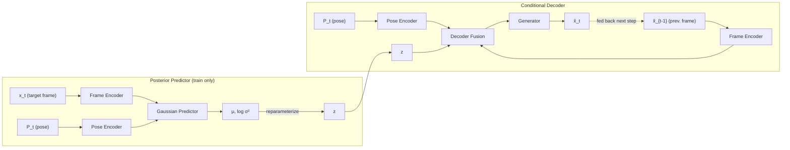

<div align="center">

# Conditional VAE for Video Prediction

**Pose-conditioned, recurrent frame generation with a Conditional Variational Autoencoder in PyTorch**

[](https://www.python.org/)
[](https://pytorch.org/)
[](https://pytorch.org/vision/)
[](LICENSE)

*Given a single starting frame and a sequence of body-pose skeletons, the model hallucinates the next 629 frames of a person dancing, one frame at a time.*

</div>

---

## Table of Contents

- [Overview](#overview)
- [How It Works](#how-it-works)
  - [Model architecture](#model-architecture)
  - [Training protocol](#training-protocol)
  - [Inference protocol](#inference-protocol)
  - [Training strategies](#training-strategies)
- [Getting Started](#getting-started)
- [Usage](#usage)
- [Project Structure](#project-structure)
- [Results](#results)
- [References](#references)

---

## Overview

Video prediction asks a model to look at the past and imagine the future. This project tackles a *conditional* flavour of the problem: in addition to the previous frame, the model is told **where the body should be** via a pose skeleton, and must render a realistic RGB frame that matches it.

The generative model is a **Conditional VAE (CVAE)**. The condition for predicting frame *x<sub>t</sub>* is the previously generated frame together with the current pose, *c<sub>t</sub> = (x̂<sub>t−1</sub>, P<sub>t</sub>)*:

$$
p_\theta(x_t \mid c_t) = \int p_\theta(x_t \mid z_t, c_t)\, p(z_t)\, dz_t,
\qquad p(z_t) = \mathcal{N}(0, I)
$$

A fixed standard-Gaussian prior is used; all conditioning enters through the decoder. At inference the model runs **autoregressively** over 630 frames, feeding each prediction back as the next input, which makes long-horizon error accumulation the central challenge.

**Key ingredients**

| Component | Role |
|---|---|
| Reparameterization trick | Differentiable sampling of *z* from the posterior *N(μ, σ²)* (network predicts log-variance for stability) |
| Teacher forcing | Ground-truth *x<sub>t−1</sub>* is substituted for *x̂<sub>t−1</sub>* with probability `tfr`, decayed over training |
| KL annealing | Time-varying weight *β* on the KL term: **cyclical**, **monotonic**, or **none** |
| PSNR evaluation | Per-frame peak signal-to-noise ratio on the 630-frame validation sequence |

---

## How It Works

### Model architecture

All sub-modules live in [`modules/`](Lab4_template/modules) and are built from residual / depth-wise convolution blocks.



| Module | Input → Output | Purpose |
|---|---|---|
| `RGB_Encoder` | 3 × 32 × 64 → `F_dim`=128 | Encodes an RGB frame into feature space |
| `Label_Encoder` | 3 × 32 × 64 → `L_dim`=32 | Encodes the pose skeleton image |
| `Gaussian_Predictor` | 160 → `N_dim`=12 | Predicts posterior *μ* and *log σ²* |
| `Decoder_Fusion` | 128 + 32 + 12 → `D_out_dim`=192 | Fuses frame, pose and latent features |
| `Generator` | 192 → 3 × 32 × 64 | Renders the output frame |

Frames are resized to **32 × 64** to fit GPU memory.

### Training protocol

Each training sample is a clip of *k* = 16 frames `{x₁ … x₁₆}` and 16 pose labels `{P₁ … P₁₆}`. The first frame is given; the model predicts the remaining 15.

For every step *t*:

1. The **posterior predictor** sees the *true* frame *x<sub>t</sub>* and pose *P<sub>t</sub>* and outputs *(μ<sub>t</sub>, log σ<sub>t</sub>²)*.
2. A latent *z<sub>t</sub>* is drawn with the reparameterization trick *z = μ + σ ⊙ ε*, *ε ~ N(0, I)*.
3. The **decoder** receives *(x̂<sub>t−1</sub>, P<sub>t</sub>, z<sub>t</sub>)* and produces *x̂<sub>t</sub>*.
4. Loss = **MSE**(x̂<sub>t</sub>, x<sub>t</sub>) + *β* · **KL**(N(μ<sub>t</sub>, σ<sub>t</sub>²) ‖ N(0, I)).

With teacher forcing enabled for the epoch, step 3 uses the ground-truth *x<sub>t−1</sub>* instead of the model's own *x̂<sub>t−1</sub>*.

### Inference protocol

The posterior predictor is discarded. Starting from the single observed frame *x₁*, the model samples *z ~ N(0, I)* and generates *x̂₂*; that prediction is then fed back as the "previous frame" to generate *x̂₃*, and so on for **629 recurrent steps**. The output sequence is exported as a GIF for visual inspection and as a CSV for scoring.

### Training strategies

**Teacher-forcing schedule.** Start at `tfr = 1.0`, hold until epoch `tfr_sde`, then decay by `tfr_d_step` each epoch so the model gradually learns to recover from its own mistakes.

**KL-annealing schedules** (after Fu et al., 2019):

| Strategy | β over training | Effect |
|---|---|---|
| Cyclical | Ramps 0 → 1 linearly, resets every `kl_anneal_cycle` epochs | Repeatedly re-opens the latent bottleneck, mitigating KL vanishing |
| Monotonic | Ramps 0 → 1 once, then stays at 1 | Standard warm-up |
| None | β = 1 throughout | Baseline, prone to posterior collapse |

**Fast-train mode.** Optionally trains on `fast_partial` (40 %) of the data for the first `fast_train_epoch` epochs to speed up convergence.

---

## Getting Started

### Prerequisites

- Python 3.11
- A CUDA-capable GPU (CPU works for smoke-tests via `--device cpu`)

### Installation

```bash
git clone https://github.com/godfathern/cvae-video-prediction.git
cd cvae-video-prediction
python -m venv .venv && source .venv/bin/activate
pip install -r Lab4_template/requirements.txt
```

### Dataset

The dataset (~5 GB of PNG frames) is **not** tracked in this repository. Place it at `Lab4_dataset/` (or anywhere, and point `--DR` to it) with this layout:

```
Lab4_dataset/
├── train/
│   ├── train_img/      23,410 frames   frame0.png … frame23409.png
│   └── train_label/    23,410 pose maps
├── val/
│   ├── val_img/           630 frames (one continuous sequence)
│   └── val_label/         630 pose maps
└── test/
    ├── test_img/        5 sequences × 1 initial frame
    └── test_label/      5 sequences × 630 pose maps
```

---

## Usage

### Train

```bash
cd Lab4_template
python Trainer.py --DR ../Lab4_dataset --save_root ../checkpoints \
    --num_epoch 70 --batch_size 2 --lr 1e-3 \
    --kl_anneal_type Cyclical --kl_anneal_cycle 10 --kl_anneal_ratio 1 \
    --tfr 1.0 --tfr_sde 10 --tfr_d_step 0.1 \
    --fast_train --fast_partial 0.4 --fast_train_epoch 5
```

Checkpoints are written to `--save_root` every `--per_save` epochs. Resume with `--ckpt_path path/to/epoch=N.ckpt`.

### Evaluate on the validation sequence

```bash
python Trainer.py --DR ../Lab4_dataset --save_root ../checkpoints \
    --ckpt_path ../checkpoints/epoch=69.ckpt --test
```

### Generate test predictions

```bash
python Tester.py --DR ../Lab4_dataset --save_root ../results \
    --ckpt_path ../checkpoints/epoch=69.ckpt --make_gif
```

This writes `pred_seq{i}.gif` for each of the 5 test sequences and `submission.csv` (630 × 6144 pixel values per sequence).

### Key arguments

| Flag | Default | Description |
|---|---|---|
| `--DR` | — | Dataset root |
| `--save_root` | — | Where checkpoints / outputs go |
| `--num_epoch` | 70 | Total epochs |
| `--train_vi_len` | 16 | Frames per training clip |
| `--val_vi_len` | 630 | Frames in the validation sequence |
| `--frame_H` / `--frame_W` | 32 / 64 | Input resolution |
| `--kl_anneal_type` | `Cyclical` | `Cyclical` · `Monotonic` · `None` |
| `--kl_anneal_cycle` | 10 | Epochs per annealing cycle |
| `--kl_anneal_ratio` | 1 | Fraction of each cycle spent ramping β |
| `--tfr` | 1.0 | Initial teacher-forcing ratio |
| `--tfr_sde` | 10 | Epoch at which `tfr` starts decaying |
| `--tfr_d_step` | 0.1 | `tfr` decay per epoch |
| `--fast_train` | off | Use a data subset for the first epochs |

---

## Project Structure

```
.
├── Lab4_template/
│   ├── Trainer.py          # VAE_Model: training loop, validation, KL annealing, teacher forcing
│   ├── Tester.py           # Recurrent 630-frame inference, GIF export, submission CSV
│   ├── dataloader.py       # Dataset_Dance: clip sampling from frame/pose PNG folders
│   ├── requirements.txt
│   └── modules/
│       ├── modules.py      # RGB_Encoder, Label_Encoder, Gaussian_Predictor, Decoder_Fusion, Generator
│       └── layers.py       # ResidualBlock, DepthConvBlock, ConvFFN, DepthConv
├── .gitignore              # excludes dataset, checkpoints, generated media
└── README.md
```

---

## Results

> Fill in after training. Suggested figures live under `docs/` (tracked despite the global image ignore).

| Experiment | KL annealing | Teacher forcing | Val PSNR (avg) |
|---|---|---|---|
| Baseline | None | decay from ep. 10 | — |
| Monotonic | Monotonic | decay from ep. 10 | — |
| Cyclical | Cyclical (cycle = 10) | decay from ep. 10 | — |

Planned analyses:

- Teacher-forcing ratio vs. training-loss curve
- Loss curves for cyclical / monotonic / no KL annealing
- Per-frame PSNR across the 630-frame validation sequence (long-horizon error accumulation)

<!--
<p align="center">
  
  
</p>
-->

---

## References

1. C. Chan *et al.*, "Everybody Dance Now," *ICCV*, 2019.
2. E. Denton and R. Fergus, "Stochastic Video Generation with a Learned Prior," *ICML*, 2018.
3. H. Fu *et al.*, "Cyclical Annealing Schedule: A Simple Approach to Mitigating KL Vanishing," *NAACL-HLT*, 2019.

---

<div align="center">
<sub>Built as part of a graduate Deep Learning course project (ÉTS Montréal, Fall 2026). Model architecture provided by the course; training pipeline, inference loop, and training strategies implemented by the author.</sub>
</div>
